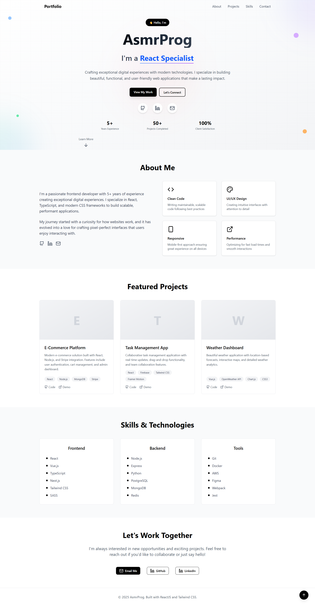

# React Portfolio 01

Modern single-page developer portfolio built with React 19 and Vite. It showcases key sections (hero, about, projects, skills, contact) plus smooth scrolling, viewport-triggered animations, and polished UI micro-interactions powered by Tailwind-style utility classes.

## Features
- Responsive sticky navigation with smooth section scrolling and mobile drawer.
- Hero block with animated background, typewriter role rotation, CTA buttons, and social stats.
- Data-driven sections (`src/data/*`) for About, Work Experience, Organizational Experience, Projects, Skills, Certifications, and Contact info.
- Resume download button and image-based certification gallery.
- Reusable hooks for viewport-triggered animations and scroll-to-top visibility.
- Accessible contact actions with prominent email/GitHub/LinkedIn links.

## Tech Stack
- React 19 + React DOM
- Vite 7
- Tailwind CSS 4 (via `@tailwindcss/vite`)
- Lucide React icon set
- ESLint 9 (flat config) for linting

## Project Structure
```
react-portfolio-01/
├─ src/
│  ├─ components/        # Presentational sections (Hero, About, Projects, etc.)
│  ├─ data/              # Centralized content & metadata
│  ├─ hooks/             # Custom hooks (intersection observer, scroll-to-top)
│  ├─ App.jsx            # Section composition + hook usage
│  └─ main.jsx           # React entry point with Vite bootstrap
├─ public/               # Static assets copied as-is to build
├─ dist/                 # Production build output (after `npm run build`)
├─ package.json
└─ README.md
```

## Getting Started
1. **Requirements**: Node.js ≥ 18 and npm ≥ 8.
2. **Install dependencies**
   ```bash
   npm install
   ```
3. **Run the dev server**
   ```bash
   npm run dev
   ```
   The Vite dev server prints the local URL (default `http://localhost:5173`).

## Scripts
| Command        | Description                                  |
|----------------|----------------------------------------------|
| `npm run dev`  | Start Vite in development mode with HMR.     |
| `npm run build`| Create an optimized production build in `dist/`. |
| `npm run preview` | Preview the production build locally.     |
| `npm run lint` | Run ESLint across the project.               |

## Customization Tips
- Update textual content and URLs inside the files under `src/data/`:
  - `hero.js` (name, roles, CTA buttons, socials, stats, and resume filename)
  - `workExperience.js` and `organizationalExperience.js` (roles, dates, bullet points, tools, and image paths)
  - `certifications.js` (certificate title, issuer, date, and image path)
  - `projects.js` (project cards + tech chips)
  - `skills.js` (skill categories)
  - `contact.js` (email/GitHub/LinkedIn links & button styles)
- Put the resume PDF at `public/resume.pdf` (or update the resume link in `src/data/hero.js`).
- Put experience images in `public/images/work-experience/` or `public/images/organizational-experience/`, and certificate images in `public/images/certifications/`. Reference them from the data files with paths such as `images/certifications/certificate.png`; PNG and JPG images are supported.
- Each experience entry uses `role`, `organization`, `period`, `logo`, `points` (an array of bullet points), `tools` (an array of names), and `images` (an array of `{ src, alt }` objects). `location` is optional. Experience cards alternate sides along a timeline on desktop. Put company logos in `public/images/work-experience/` and use paths like `images/work-experience/company.png`. For example:
  ```js
  {
    role: "Data Engineer Intern",
    organization: "Example Company",
    period: "Jan 2025 - Jun 2025",
    logo: "images/work-experience/example-company.png",
    points: ["Built and maintained data pipelines."],
    tools: ["Python", "SQL"],
    images: [{ src: "images/work-experience/pipeline.png", alt: "Data pipeline dashboard" }]
  }
  ```
- Each certification entry uses `title`, `issuer`, and `image`; `date` is optional. The `image` value points to a PNG or JPG under `public/`.
- Modify styling and layout inside component files if you want a different visual treatment.
- Swap icons by importing any Lucide icon and replacing the JSX in the relevant component.

## Deployment
1. Run `npm run build`.
2. Deploy the generated `dist/` folder to any static host (Vercel, Netlify, GitHub Pages, Cloudflare Pages, etc.).
3. Ensure the root path rewrites to `index.html` when using SPA hosting.

## Quality Checks
Before shipping, run:
```bash
npm run lint
npm run build
```
This validates code style and ensures the production bundle builds without errors.

# Screenshot
Here we have project screenshot :

